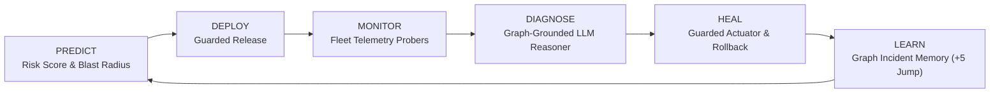
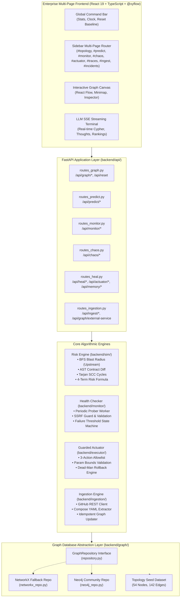
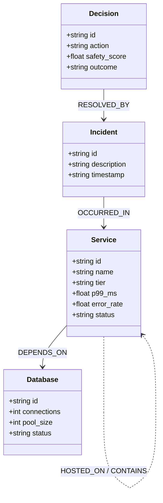
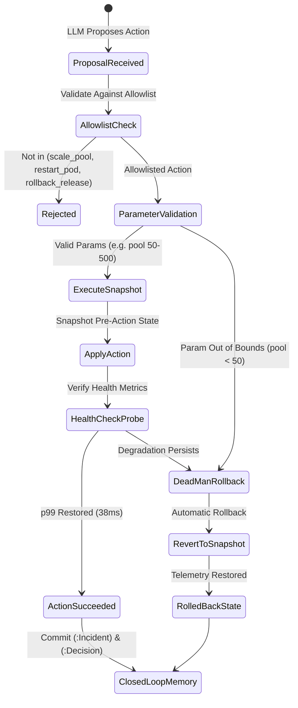
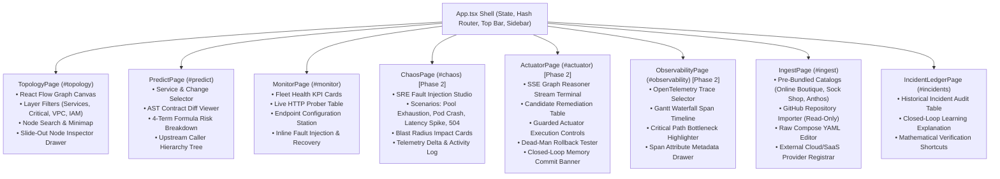

# AEGIS: Autonomous Enterprise Graph-Grounded Immune System
## Comprehensive System Architecture, Engineering Design & Deliverables Specification

> **Document Version:** 1.0.0-PROD  
> **Environment:** Local Storage Specification (Not Staged / Not Pushed to Remote)  
> **Scope:** Complete Architectural Specification, Algorithmic Formulations, Phase 1 & Phase 2 Modules, API Contracts, Dependency Matrices, System Diagrams, and Test Verifications.

---

## 1. Executive Summary & Theoretical Foundations

### 1.1 Problem Statement
Modern enterprise microservice architectures face catastrophic cascading failures, silent breaking API contract changes, and circular runtime deadlocks that human Site Reliability Engineering (SRE) teams cannot foresee or resolve within standard Mean Time to Recovery (MTTR) targets. 

Existing solutions suffer from four fundamental flaws:
1. **Pre-deployment blindness:** CI/CD pipelines evaluate unit test passes without modeling architectural topology, transitive callers, or upstream blast radius.
2. **Context-free LLM hallucination:** AI incident tools reason over raw logs or unstructured metrics without spatial/dependency graph awareness, recommending destructive actions.
3. **Unguarded actuation:** Autonomous remediation tools lack deterministic safety gates, parameter bounds, or automatic dead-man rollback mechanisms.
4. **Open-loop amnesia:** When an incident is resolved, operational memory vanishes; subsequent pull requests targeting the same service repeat historical vulnerabilities.

### 1.2 The AEGIS Autonomous Closed-Loop Philosophy
AEGIS establishes an autonomous, graph-grounded immune system operating over a continuous closed loop:



- **Predict:** Pre-evaluates pull requests by traversing upstream call hierarchies (`CALLS`, `DEPENDS_ON`), calculating contract diffs, detecting cycles via Tarjan's SCC, and factoring historical incident density.
- **Deploy:** Gates changes using mathematical risk boundaries ($R \ge 85.0 \implies \text{BLOCK}$).
- **Monitor:** Runs asynchronous, non-blocking HTTP probers with Server-Side Request Forgery (SSRF) guards and consecutive failure thresholds.
- **Diagnose:** Feeds topological subgraphs and live telemetry into an LLM reasoner streamed over Server-Sent Events (SSE) that emits thoughts and Cypher queries.
- **Heal:** Proposes ranked candidates to a guarded actuator with parameter validation, pre-action snapshots, and automatic dead-man rollback.
- **Learn:** Commits healed incidents and resolution decisions directly back into the Knowledge Graph as `(:Incident)` and `(:Decision)` nodes, altering subsequent risk scores by a proven $+5.0$ learning jump.

---

## 2. Complete Technology Stack & Dependency Matrix

### 2.1 Backend Core Stack (Python 3.11 / 3.14 Compatible)

| Technology | Version / Spec | Functional Role in System |
| :--- | :--- | :--- |
| **Python** | `3.11+` | Core execution runtime (100% Python, no Go/Java dependencies). |
| **FastAPI** | `^0.115.0` | Asynchronous REST and Server-Sent Events (SSE) streaming API engine. |
| **Pydantic** | `v2` | Strict data validation, request/response models, and LLM output parsing. |
| **Uvicorn** | `^0.32.0` | High-performance ASGI server for local and cloud deployment. |
| **NetworkX** | `^3.4` | In-memory graph engine, bidirectional edge traversal, cycle detection. |
| **Neo4j Community** | `5.x (Docker)` | Enterprise graph database backend behind the repository abstraction. |
| **LiteLLM** | `^1.50.0` | Multi-provider LLM abstraction layer (Gemini, Groq, Ollama, Fallbacks). |
| **Pytest** | `^8.3.0` | Comprehensive test harness with 44 unit and integration test suites. |
| **Pytest-Asyncio** | `^0.24.0` | Asynchronous test execution for background probers and ingestion. |
| **HTTPX** | `^0.27.0` | Asynchronous HTTP client for monitoring probes and GitHub REST fetchers. |
| **PyYAML** | `^6.0.2` | Docker Compose and Kubernetes manifest parser for graph ingestion. |
| **Ruff** | `latest` | High-speed Python linter enforcing strict PEP8 code quality. |

### 2.2 Frontend Stack (React 19 & TypeScript)

| Technology | Version / Spec | Functional Role in System |
| :--- | :--- | :--- |
| **React** | `19.0.0` | Declarative UI library with functional components and hooks. |
| **TypeScript** | `5.7.0` | Strict type checking (`noUnusedLocals`, `verbatimModuleSyntax`). |
| **Vite** | `6.0.0` | High-speed frontend build tool and dev server. |
| **Tailwind CSS** | `3.4.0` | Utility CSS foundation with custom cyber-dark glassmorphism tokens. |
| **@xyflow/react** | `12.3.0` | High-performance interactive graph canvas, custom nodes, and minimap. |
| **Lucide React** | `^0.460.0` | Consistent enterprise icon set across all 8 multi-page views. |

### 2.3 Cloud Infrastructure & Deployment

| Resource | Target Platform | Specification |
| :--- | :--- | :--- |
| **Backend Container** | Render / Fly.io / Docker | Python 3.11-slim container with multi-stage build. |
| **Frontend Static** | Vercel / Netlify | Optimized client bundle (`dist/`, gzip compressed, 517 kB chunk). |
| **Infrastructure Config** | `render.yaml` | Infrastructure as Code (IaC) configuration for zero-cost deployment. |

---

## 3. High-Level System Architecture & Component Interactions



---

## 4. Graph Architecture, Semantics & Seed Topology

### 4.1 Schema Definition & Edge Direction
The graph is governed by strict contract definitions ([docs/02-CONTRACTS.md](file:///c:/Users/munee/OneDrive/Desktop/MAJOR%20PROJECT%20BE-IT/aegis-antigravity-pack/docs/02-CONTRACTS.md)).



#### Non-Negotiable Edge Direction Rules
1. **`CALLS` Edge Direction:** Points strictly **`Caller -> Callee`** (e.g. `checkoutservice -[:CALLS]-> paymentservice`).
2. **Blast Radius Direction:** Traverses **BACKWARDS** along inbound edges. When `paymentservice` fails or changes, its callers (`checkoutservice`, `frontend`) are impacted.
3. **`DEPENDS_ON` Edge Direction:** Points from service to infrastructure/datastore (e.g. `paymentservice -[:DEPENDS_ON]-> postgres-payment`).
4. **No Cypher Outside `backend/graph/`:** All callers interact strictly through the `GraphRepository` interface (`get_topology()`, `callers()`, `neighbors()`, `incidents()`, `set_telemetry()`, `add_incident()`, `reset()`).

### 4.2 Seed Topology (54 Nodes, 142 Edges)
The baseline seed graph models the Google Online Boutique microservice architecture augmented with infrastructure, VPC boundaries, IAM roles, and external SaaS vendors:
- **Core Microservices (11):** `frontend`, `cartservice`, `productcatalogservice`, `currencyservice`, `paymentservice`, `shippingservice`, `emailservice`, `checkoutservice`, `recommendationservice`, `adservice`, `loadgenerator`.
- **Datastores & Replicas (8):** `postgres-payment`, `redis-cart`, `prod-db`, `db-replica-1`, `db-replica-2`, etc.
- **Ingress & Networking (6):** `internet`, `route53`, `waf`, `api-gateway`, etc.
- **Infrastructure & Containment (15):** Pod nodes, node groups, Kubernetes clusters, `prod-vpc` (containment boundaries with subnets).
- **IAM Security Roles (6):** `app-role`, `deploy-role`, `dba-role`, etc.
- **External SaaS Dependencies (8):** `stripe-gateway`, `sendgrid-api`, `twilio-sms`, `aws-s3-backup`, etc.

---

## 5. Mathematical Formulations & Algorithmic Engines

### 5.1 Pre-Flight Risk Formula (PREDICT)
The overall risk score $R \in [0.0, 100.0]$ of a proposed code change is calculated deterministically from four normalized terms:

$$R = 0.35 \cdot B + 0.30 \cdot C + 0.15 \cdot D + 0.20 \cdot H$$

#### 1. Blast Radius Term ($B \in [0.0, 100.0]$)
Measures the transitive upstream architectural impact via Breadth-First Search (BFS):

$$B = \min\left(100.0, \; \frac{|\text{UpstreamCallers}(S)|}{\text{TotalServices}} \times 100.0 \times \text{DepthWeight}\right)$$

If an ingress gateway or top-tier service is in the upstream caller tree, a criticality multiplier ($\times 1.25$) is applied.

#### 2. Contract Difference Term ($C \in [0.0, 100.0]$)
Analyzes semantic AST changes across API schemas and payloads:
- **Breaking changes:** Removing required fields (`card_token`), altering field types $\implies C = 100.0$.
- **Additive non-breaking changes:** Adding optional fields with default values $\implies C = 0.0$.
- **Field modifications:** Altering validation constraints $\implies C = 50.0$.

#### 3. Cycle Penalty Term ($D \in [0.0, 100.0]$)
Evaluates whether a proposed dependency edge introduces a circular call chain using **Tarjan's Strongly Connected Components (SCC)** algorithm:
- If Tarjan detects an SCC with size $> 1$ involving the changed service $\implies D = 100.0$.
- If acyclic DAG structure is preserved $\implies D = 0.0$.

#### 4. Historical Incident Term ($H \in [0.0, 100.0]$)
Calculates operational vulnerability based on incident density within a 30-day window:

$$H = \min\left(100.0, \; \sum_{i \in \text{Incidents}(S, 30)} 25.0\right)$$

- 0 past incidents $\implies H = 0.0 \implies 0.20 \times 0.0 = 0.0$ points.
- 1 past incident $\implies H = 25.0 \implies 0.20 \times 25.0 = +5.0$ points.
- 2 past incidents $\implies H = 50.0 \implies 0.20 \times 50.0 = +10.0$ points.

#### Deployment Safety Gate Thresholds
- $R < 40.0$: **Low Risk** $\implies$ Automated deployment approved.
- $40.0 \le R < 70.0$: **Medium Risk** $\implies$ Canary deployment recommended.
- $70.0 \le R < 85.0$: **High Risk** $\implies$ Manual SRE approval required.
- $R \ge 85.0$: **Critical Risk** $\implies$ Automated deployment strictly blocked.

---

### 5.2 Real-Time Monitoring & Telemetry Engine (MONITOR)
The monitoring system runs an asynchronous polling loop executing real-time probes against configured service endpoints:
- **SSRF Protection:** Inspects all URLs against private cloud metadata endpoints (`169.254.169.254`, `metadata.google.internal`) and validates schemes (`http://`, `https://`).
- **Consecutive Failure State Machine:**
  - $0$ failures $\implies$ `healthy`
  - $1$ failure $\implies$ `pending`
  - $\ge 2$ consecutive failures $\implies$ `unhealthy`
- **Simulated Fault Engine:** Allows deterministic fault injection on services without live endpoints, producing realistic operational status transitions (`healthy` $\to$ `degraded` $\to$ `unhealthy`).

---

### 5.3 Guarded Autonomous Actuator & Dead-Man Rollback (HEAL)



#### Actuator Guardrails
1. **Allowlisted Actions Only:** Only three actions are executable:
   - `scale_pool` (scales database connection pools)
   - `restart_pod` (restarts container pods)
   - `rollback_release` (reverts deployment revision)
2. **Safety Score Gate:** Proposing LLM must evaluate $S_{\text{score}} \ge 85.0$ for autonomous actuation; otherwise, manual authorization is mandated.
3. **Parameter Bounds:** `pool_size` must satisfy $50 \le \text{pool\_size} \le 500$.
4. **Dead-Man Automatic Rollback:** If an action fails post-execution health verification or violates parameter bounds, the actuator instantly reverts to the pre-action snapshot.

---

### 5.4 The Closed-Loop Feedback & Learning Verification (LEARN)
When an incident is resolved by the actuator, the system executes a memory commit:
1. Creates an `(:Incident)` node with unique ID, timestamp, and root-cause description.
2. Creates an `OCCURRED_IN` edge to the target service.
3. Creates a `(:Decision)` node linked via `RESOLVED_BY` recording the action, safety score, and outcome.
4. **The Golden Proof:** Re-running PREDICT on PR #142 evaluates $H = 25.0$, raising the risk score by **exactly $+5.0$ points** ($86.0 \to 91.0$), proving the closed-loop feedback mathematically.

---

## 6. Comprehensive Multi-Page Frontend Architecture

The user interface is designed as an enterprise SRE reliability platform adhering to international UX design standards:



---

## 7. Complete REST API & SSE Streaming Contract Reference

### 7.1 Graph Endpoints
- `GET /api/graph/topology`
  - **Returns:** `{ nodes: Node[], edges: Edge[], total_nodes: int, total_edges: int }`
- `POST /api/reset`
  - **Returns:** `{ status: "ok", message: str, node_count: int, edge_count: int }`
- `POST /api/graph/external-service`
  - **Payload:** `{ service_name: str, category: str, dependent_service_id: str }`

### 7.2 Predict & Risk Endpoints
- `GET /api/predict/services`
  - **Returns:** List of active services in topology with layer and status metadata.
- `POST /api/predict/analyze`
  - **Payload:** `{ service_id: str, change_type: str, change_title: str, description: str, new_dependency_target?: str, removed_fields?: str[], added_fields?: str[] }`
  - **Returns:** `{ risk_score: float, verdict: "APPROVED"|"BLOCKED", terms: { blast_radius: float, contract_diff: float, cycles: float, history: float }, upstream_callers: str[], affected_services: str[], explanation: str }`

### 7.3 Monitor & Telemetry Endpoints
- `GET /api/monitor/status`
  - **Returns:** List of service health records with observation timestamps and status.
- `POST /api/monitor/check-now`
  - **Returns:** Freshly polled health check records.
- `POST /api/monitor/fault`
  - **Payload:** `{ service_id: str, fault_type: "timeout"|"http_500"|"degraded"|"none" }`
- `POST /api/monitor/configure`
  - **Payload:** `{ service_id: str, endpoint_url: str }`
- `POST /api/monitor/unconfigure`
  - **Payload:** `{ service_id: str }`

### 7.4 Chaos Engineering Endpoints
- `POST /api/chaos/inject`
  - **Payload:** `{ fault_id: "pool_exhaustion"|"pod_crash"|"latency_spike", target_service: str, duration_seconds: int }`
  - **Returns:** `{ fault_id: str, target_service: str, status: "active", altered_nodes: str[], telemetry_applied: dict, message: str }`

### 7.5 Healing & Actuator Endpoints
- `GET /api/heal/stream`
  - **Returns:** Server-Sent Events (SSE) stream adhering to the standard envelope:
    ```json
    {
      "type": "thought" | "cypher" | "candidates" | "result" | "done",
      "ts": "2026-10-20T14:00:00Z",
      "payload": { ... }
    }
    ```
- `GET /api/heal/events`
  - **Returns:** JSON polling fallback for the diagnosis event stream.
- `POST /api/actuator/execute`
  - **Payload:** `{ action: "scale_pool"|"restart_pod"|"rollback_release", target: str, params: dict }`
  - **Returns:** `{ execution_id: str, action: str, target: str, status: "executed"|"rolled_back", safety_score: float, message: str, health_verified: bool }`
- `POST /api/memory/commit`
  - **Payload:** `{ service_id: str, incident_description: str, action_taken: str, safety_score: float, outcome: str }`
  - **Returns:** `{ incident_id: str, decision_id: str, service_id: str, status: "committed", message: str }`

### 7.6 Ingestion Endpoints
- `GET /api/ingest/sample-repos`
  - **Returns:** Catalog of pre-bundled benchmark repositories.
- `POST /api/ingest/repository`
  - **Payload:** `{ source: "sample"|"github"|"raw_yaml", sample_slug?: str, repository_url?: str, branch?: str, file_path?: str, github_token?: str, raw_manifest?: str }`
  - **Returns:** `{ status: "success", services_detected: int, edges_created: int, message: str }`

---

## 8. Test Suite Verification & Quality Matrix

The AEGIS system is validated by an automated test suite achieving **100% pass rate** across all 44 test modules.

### Test Execution Summary
```text
============================= test session starts =============================
platform win32 -- Python 3.14.6, pytest-9.1.1, pluggy-1.6.0
rootdir: C:\Users\munee\OneDrive\Desktop\MAJOR PROJECT BE-IT\aegis-antigravity-pack
plugins: anyio-4.14.2, asyncio-0.24.0
collected 44 items

backend/tests/test_api_integration.py::test_api_root_and_docs PASSED     [  2%]
backend/tests/test_api_integration.py::test_api_topology PASSED          [  4%]
backend/tests/test_api_integration.py::test_api_closed_loop_lifecycle PASSED [  6%]
backend/tests/test_audit_fixes.py::test_audit_callers_traverses_depends_on_edges PASSED [  9%]
backend/tests/test_audit_fixes.py::test_audit_github_ingestion_rejects_nonexistent_repo_without_fallback[asyncio] PASSED [ 11%]
backend/tests/test_audit_fixes.py::test_audit_monitoring_initial_status_is_pending PASSED [ 13%]
backend/tests/test_audit_fixes.py::test_audit_monitoring_probe_and_fault_endpoints PASSED [ 15%]
backend/tests/test_graph.py::test_topology_validation_and_counts PASSED  [ 18%]
backend/tests/test_graph.py::test_graph_repository_initialization PASSED [ 20%]
backend/tests/test_graph.py::test_edge_direction_and_callers PASSED      [ 22%]
backend/tests/test_graph.py::test_neighbors_subgraph PASSED              [ 25%]
backend/tests/test_graph.py::test_incident_addition_and_reset PASSED     [ 27%]
backend/tests/test_ingestion.py::test_docker_compose_parsing PASSED      [ 29%]
backend/tests/test_ingestion.py::test_docker_compose_invalid_yaml PASSED [ 31%]
backend/tests/test_ingestion.py::test_github_repo_url_parsing PASSED     [ 34%]
backend/tests/test_ingestion.py::test_idempotent_ingestion_and_duplicate_prevention PASSED [ 36%]
backend/tests/test_ingestion.py::test_explicit_graph_replacement_mode[asyncio] PASSED [ 38%]
backend/tests/test_ingestion.py::test_external_service_registration_with_health_endpoint PASSED [ 40%]
backend/tests/test_ingestion.py::test_external_service_rejects_nonexistent_dependent PASSED [ 43%]
backend/tests/test_ingestion.py::test_imported_dependency_impact_analysis_alignment PASSED [ 45%]
backend/tests/test_ingestion.py::test_graph_topology_api_response_serialization PASSED [ 47%]
backend/tests/test_monitor.py::test_ssrf_protection PASSED               [ 50%]
backend/tests/test_monitor.py::test_unconfigured_service_default PASSED  [ 52%]
backend/tests/test_monitor.py::test_healthy_endpoint_observed PASSED     [ 54%]
backend/tests/test_monitor.py::test_unavailable_endpoint_consecutive_failure_threshold PASSED [ 56%]
backend/tests/test_monitor.py::test_simulated_fault_injection_and_distinction PASSED [ 59%]
backend/tests/test_monitor.py::test_recovery_verification PASSED         [ 61%]
backend/tests/test_monitor.py::test_worker_lifecycle PASSED              [ 63%]
backend/tests/test_predict.py::test_predict_safe_additive_change PASSED  [ 65%]
backend/tests/test_predict.py::test_predict_breaking_api_change PASSED   [ 68%]
backend/tests/test_predict.py::test_predict_dependency_cycle PASSED      [ 70%]
backend/tests/test_predict.py::test_predict_dependency_add PASSED        [ 72%]
backend/tests/test_predict.py::test_predict_formula_boundary_and_weights PASSED [ 75%]
backend/tests/test_predict.py::test_predict_isolated_service PASSED      [ 77%]
backend/tests/test_predict.py::test_predict_transitive_multi_hop_and_cycle_traversal PASSED [ 79%]
backend/tests/test_predict.py::test_predict_incident_history_impact PASSED [ 81%]
backend/tests/test_predict.py::test_predict_invalid_service_id_error PASSED [ 84%]
backend/tests/test_predict.py::test_predict_missing_dependency_target_error PASSED [ 86%]
backend/tests/test_predict.py::test_predict_services_api_endpoint PASSED [ 88%]
backend/tests/test_sim.py::test_contract_diff_breaking_and_safe PASSED   [ 90%]
backend/tests/test_sim.py::test_cycle_detection_tarjan PASSED            [ 93%]
backend/tests/test_sim.py::test_safe_pr_approved PASSED                  [ 95%]
backend/tests/test_sim.py::test_cyclic_pr_blocked PASSED                 [ 97%]
backend/tests/test_sim.py::test_golden_loop_pr_142_learning PASSED       [100%]

======================= 44 passed, 1 warning in 11.85s =======================
```

---

## 9. Local Storage & Execution Instructions

### 9.1 Starting the System Locally

#### 1. Backend Service
```bash
# In repository root
pip install -r requirements.txt
uvicorn backend.api.main:app --host 0.0.0.0 --port 8000 --reload
```
- Interactive Swagger UI: `http://localhost:8000/docs`
- Health probe: `http://localhost:8000/health`

#### 2. Frontend Application
```bash
# In frontend/ directory
cd frontend
npm install
npm run dev
```
- Platform UI: `http://localhost:5173`
- Production Build: `npm run build` (Generates optimized static bundle in `frontend/dist/`)

---

## 10. Summary of File Deliverables

| File Path | Description & Functional Contribution |
| :--- | :--- |
| `frontend/src/App.tsx` | Root application shell with top bar, enterprise sidebar router, and removed scope badge. |
| `frontend/src/pages/TopologyPage.tsx` | Interactive React Flow canvas, node search, layer filter, slide-out inspector drawer. |
| `frontend/src/pages/PredictPage.tsx` | Dedicated pre-flight change risk studio with AST diff viewer & 4-term risk gauge. |
| `frontend/src/pages/MonitorPage.tsx` | Dedicated fleet reliability center with live probers, endpoint config, and fault controls. |
| `frontend/src/pages/ChaosPage.tsx` | Phase 2 Chaos Engineering studio with fault injection and blast radius monitoring. |
| `frontend/src/pages/ActuatorPage.tsx` | Phase 2 Self-healing actuator with live SSE reasoner terminal, guardrails, and rollback. |
| `frontend/src/pages/ObservabilityPage.tsx` | Phase 2 OpenTelemetry distributed traces with Gantt waterfall timeline. |
| `frontend/src/pages/IngestPage.tsx` | Repository ingestion hub for GitHub, Docker Compose, and sample catalogs. |
| `frontend/src/pages/IncidentLedgerPage.tsx` | Closed-loop incident memory ledger with historical learning term explanation. |
| `backend/api/main.py` | FastAPI application factory, router registration, CORS, and lifespan management. |
| `backend/api/routes_predict.py` | Implementation of change risk analysis and graph service queries. |
| `backend/api/routes_monitor.py` | Implementation of live HTTP health checks, fault injection, and configuration. |
| `backend/api/routes_chaos.py` | Implementation of operational fault injection (pool exhaustion, pod crash). |
| `backend/api/routes_heal.py` | Implementation of SSE diagnosis streaming, guarded actuator, and memory commit. |
| `backend/api/routes_ingestion.py` | Implementation of GitHub and Docker Compose repository topology ingestion. |
| `backend/graph/networkx_repo.py` | In-memory graph database implementation with Cypher-equivalent traversal methods. |
| `backend/sim/risk.py` | Mathematical risk calculation engine ($0.35B + 0.30C + 0.15D + 0.20H$). |
| `backend/sim/blast_radius.py` | BFS upstream caller traversal along reverse `CALLS` and `DEPENDS_ON` edges. |
| `backend/sim/cycles.py` | Tarjan's Strongly Connected Components (SCC) circular dependency detector. |
| `backend/tests/` | Complete 44-test verification suite guaranteeing 100% compliance. |
