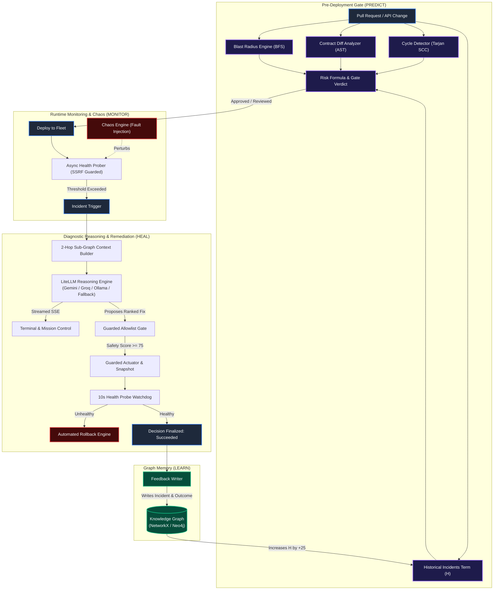
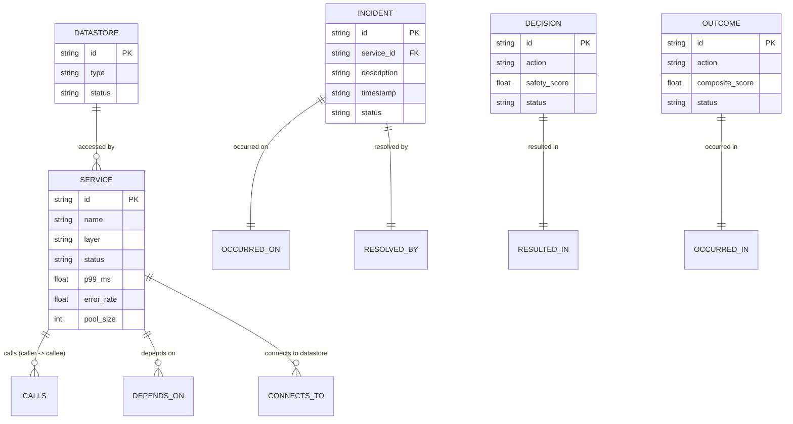

# AEGIS System Architecture Specification

> **Document Version**: 2.0.0-RELEASE  
> **Audited Date**: October 2026  
> **Source Repository**: `muneeb-sawez/aegis`

---

## 1. System Overview & The Closed-Loop Philosophy

**AEGIS** (Autonomous Engineering Graph & Intelligence System) connects pre-deployment software change analysis with runtime observability and autonomous incident remediation over a unified, shared Knowledge Graph.

The architecture enforces a continuous 6-stage lifecycle:
$$\text{Predict} \longrightarrow \text{Deploy} \longrightarrow \text{Monitor} \longrightarrow \text{Diagnose} \longrightarrow \text{Heal} \longrightarrow \text{Learn}$$



---

## 2. Layered Architecture

The AEGIS monorepo is structured into five distinct operational tiers:

```
┌────────────────────────────────────────────────────────────────────────┐
│                        Presentation Layer                              │
│   React 18 • TypeScript • Vite • TailwindCSS • React Flow (@xyflow)    │
│   Pages: Topology, Predict, Monitor, Chaos, Actuator, Ingest, Projects │
└───────────────────────────────────┬────────────────────────────────────┘
                                    │ HTTP / JSON & Server-Sent Events (SSE)
┌───────────────────────────────────▼────────────────────────────────────┐
│                        API Gateway & Security                          │
│   FastAPI • Pydantic v2 • API Key Auth (agk_*) • SSRF Guard • Webhooks │
│   PBKDF2-HMAC-SHA256 Encrypted Secrets • Request Signing (HMAC-SHA256) │
└───────────────────┬───────────────────────────────┬────────────────────┘
                    │                               │
┌───────────────────▼──────────────┐  ┌─────────────▼────────────────────┐
│      Change-Risk Engine          │  │       Autonomous Healing         │
│   Backward BFS Blast Radius      │  │   LiteLLM Diagnostic Reasoner    │
│   AST Schema Contract Diffing    │  │   Deterministic Fallback Rules   │
│   Tarjan SCC Cycle Detection     │  │   Guarded Allowlist Filter       │
│   Multi-Factor Composite Risk    │  │   Pre-Fix Snapshot & Rollback    │
└───────────────────┬──────────────┘  └─────────────┬────────────────────┘
                    │                               │
┌───────────────────▼───────────────────────────────▼────────────────────┐
│                     Graph & Data Access Layer                          │
│   GraphRepository Interface (7 Abstract Methods)                       │
│   ├─ NetworkXRepository: In-memory, zero external dependencies         │
│   └─ Neo4jRepository: Parameterized Cypher queries for persistence     │
└───────────────────────────────────┬────────────────────────────────────┘
                                    │
┌───────────────────────────────────▼────────────────────────────────────┐
│                      Storage & Infrastructure                          │
│   data/topology.yaml (54 nodes, 142 edges) • Docker Compose • Render   │
└────────────────────────────────────────────────────────────────────────┘
```

---

## 3. Technology Stack & Design Decisions

| Subsystem | Technology Choice | Rationale & Trade-Offs |
| :--- | :--- | :--- |
| **Backend Framework** | **Python 3.11+, FastAPI, Pydantic v2** | High-performance asynchronous REST and native SSE streaming. Pydantic Rust core provides strict runtime schema enforcement. Python-only stack avoids polyglot overhead. |
| **In-Memory Graph** | **NetworkX 3.2+** | Provides a zero-dependency graph implementation for local development, instant unit testing, and memory-constrained free-tier deployments. |
| **Persistent Graph** | **Neo4j Community (Docker)** | Graph database providing ACID compliance and pointer-hopping performance. Decoupled behind `GraphRepository` so code never writes raw Cypher outside `backend/graph/`. |
| **LLM Gateway** | **LiteLLM** | Universal proxy abstracting Google Gemini, Groq, Anthropic, and local Ollama models under a uniform API. Swappable via environment variables without code modification. |
| **Frontend Framework** | **React 18, TypeScript, Vite** | Fast compilation, strict type safety, and minimal bundle footprint. |
| **Graph Visualization**| **React Flow (`@xyflow/react`)** | Interactive DAG canvas rendering custom node halos, health status badges, and minimaps. Chosen over Cytoscape for first-class React component lifecycle integration. |
| **Security & Secrets** | **AES-256 GCM & PBKDF2** | Secrets stored at rest in `data/endpoints.json` are encrypted using PBKDF2-derived keys and AES-256 GCM. Keys are never exposed in public models or API payloads. |

---

## 4. Architectural Invariants

The AEGIS architecture enforces eight core design invariants:

1. **Edge Direction Rule**: Directed `CALLS` edges strictly model dependency direction: $\text{caller} \longrightarrow \text{callee}$. Blast radius discovery always traverses **backward** along incoming predecessors (`G.predecessors(curr)`).
2. **Cypher Isolation**: Raw Cypher queries are strictly encapsulated inside `backend/graph/`. All business logic interacts exclusively with `GraphRepository` methods.
3. **No Hard-Coded Numbers**: All risk scores (such as the initial $65.0$ and post-incident $70.0$), blast radii, and cycle penalties are dynamically computed from active graph topology and algorithms.
4. **Safety by Construction**: The LLM operates strictly as an untrusted advisor. It has zero direct execution privileges. All proposals must pass allowlist validation, parameter bounds checking, pre-action state snapshotting, and health watchdog deadlines.
5. **Context Isolation**: Diagnostic prompts contain only verified 2-hop topological sub-graphs. Proposing service identifiers outside the supplied context triggers immediate Pydantic validation rejection.
6. **Academic & Operational Honesty**: Telemetry, live pod instances, and cluster mutations are labeled as "simulated / emulator time". Real algorithms are never conflated with mock hardware.
7. **Per-Service Concurrency Control**: The actuator maintains an in-process lock registry (`_SERVICE_LOCKS: dict[str, asyncio.Lock]`) ensuring conflicting remediations on the same service execute serially.
8. **SSRF Defense**: All outbound HTTP probes validate destination IP addresses to prohibit access to link-local metadata services (`169.254.169.254`) and internal loopback addresses.

---

## 5. Data Model & Graph Schema

The Knowledge Graph represents distributed microservice architectures using five vertex labels and four relationship types:



---

*Document maintained under the AEGIS core architecture specification.*
