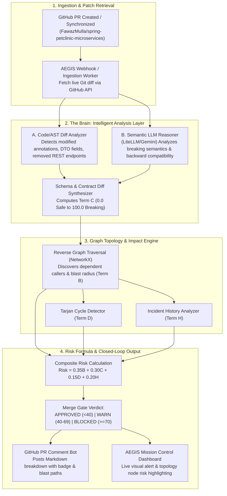

# Intelligent Breaking Change Detection & Dynamic PR Engine

## 1. Executive Summary & Objective

The objective of this major feature is to transition AEGIS from pre-baked PR testing payloads (`pr_142_breaking.json`) into an **autonomous, intelligent Git/PR change-risk reasoning engine**.

When an examiner or user raises a Pull Request on **`FawazMulla/spring-petclinic-microservices`**:
1. AEGIS dynamically extracts the live patch/diff via GitHub REST API.
2. The **Reasoning Brain** (combining AST structural code analysis, OpenAPI contract diffing, and LLM semantic reasoning) inspects the changes to detect breaking API contracts, removed fields, modified endpoints, or schema discrepancies.
3. AEGIS walks the live **Topology Graph** backwards (Reverse BFS) to locate every dependent caller service (e.g., `api-gateway` calling `customers-service`).
4. The system calculates a mathematically grounded risk score ($0.35B + 0.30C + 0.15D + 0.20H \ge 70$, Verdict: **BLOCKED**).
5. AEGIS posts a detailed risk report as a comment directly onto the GitHub PR and updates the Mission Control Dashboard in real time.
6. If the examiner requests **another PR or a different change**, the engine dynamically creates and assesses new scenarios on-demand across any microservice without hardcoded rules.

---

## 2. Core Architecture: The "Brain"

The Brain operates as a **tri-layer intelligence pipeline**:



---

## 3. Detailed Component Implementation

### Layer 1: Intelligent Git Diff & AST Schema Extractor
* **File Target:** `backend/webhooks/git_diff_analyzer.py`
* **Functionality:**
  - Connects to GitHub API using the project OAuth/PAT token (`github_access_token` stored in `data/github_auth.json`).
  - Downloads the diff for each modified file in the PR.
  - Detects Java/Spring annotations:
    - `@RestController`, `@GetMapping`, `@PostMapping`, `@PutMapping`, `@DeleteMapping`
    - Class fields in Request/Response DTOs (e.g. `OwnerResponse`, `PetDetails`)
  - Identifies breaking patterns dynamically:
    - Field removed or renamed in DTO (breaking for JSON deserialization).
    - Endpoint path altered (e.g. `/owners` changed to `/v2/owners`).
    - HTTP method changed (e.g. `GET` changed to `POST`).
    - Added non-optional query parameter or path variable.
  - Builds dynamic `old_schema` and `new_schema` dictionaries on the fly without hardcoded files.

### Layer 2: LLM Fallback & Semantic Reasoner
* **File Target:** `backend/agent/pr_reasoner.py`
* **Functionality:**
  - When code changes are subtle (e.g. validation rules tightened or response payload format changed), LiteLLM prompts Gemini/Groq:
    - Analyzes breaking semantics vs backward compatibility.
    - Determines if upstream consumer `api-gateway` will experience runtime contract failures.
  - Gracefully falls back to the deterministic AST parser if external LLM API rate limits are reached.

### Layer 3: Webhook Pipeline Upgrade
* **File Target:** `backend/webhooks/processor.py`
* **Enhancements:**
  - Remove all fallback dependencies on static files (`pr_142_breaking.json`).
  - Read PR number, repository owner, and repo name directly from GitHub webhook payload.
  - Call the `git_diff_analyzer` to extract real changed contracts.
  - Run `assess_change_risk(pr_payload, repo)` against the project's real topology (`spring-petclinic-microservices` or `demo`).
  - Post formatted PR comment via GitHub REST API.

### Layer 4: Examiner Dynamic Scenario CLI & Automation
* **File Target:** `scripts/examiner_pr_engine.py`
* **Capabilities for Review Demonstration:**
  - Pre-configured catalog of distinct microservice breaking changes:
    1. **Scenario 1 (Customers Service):** Remove `telephone` attribute from `Owner.java` REST DTO.
    2. **Scenario 2 (Visits Service):** Alter `/pets/{petId}/visits` endpoint path to `/pets/{petId}/medical-visits`.
    3. **Scenario 3 (Vets Service):** Change `specialties` list structure in `Vet.java`.
    4. **Scenario 4 (Additive / Safe Change):** Add optional `notes` field (proves the engine correctly scores Safe changes as **Approved**).
  - Flags for the presenter:
    ```powershell
    # Raise breaking PR #1 immediately
    python scripts/examiner_pr_engine.py --create --scenario customers-breaking

    # Examiner says "do it again on a different service":
    python scripts/examiner_pr_engine.py --create --scenario visits-breaking

    # Examiner says "show me a safe PR that passes":
    python scripts/examiner_pr_engine.py --create --scenario safe-additive
    ```

---

## 4. Verification and Rollout Sequence

| Step | Action | Expected Outcome |
| :--- | :--- | :--- |
| **1** | Implement `git_diff_analyzer.py` and unit tests | Validates diff parsing on real Spring Boot code snippets. |
| **2** | Update `processor.py` to invoke live diff analysis | Webhook dynamically processes any PR ID from GitHub. |
| **3** | Implement `examiner_pr_engine.py` using stored GitHub credentials | Capable of branching, committing, and opening PRs via GitHub API. |
| **4** | Execute Scenario 1 live | Real PR created on `FawazMulla/spring-petclinic-microservices`. |
| **5** | Verify AEGIS Assessment | AEGIS scores risk $\ge 70$, marks verdict as **Blocked**, and posts comment to the new PR. |
| **6** | Verify Secondary Examiner Trigger | Run Scenario 2 to confirm the system evaluates another PR dynamically. |
